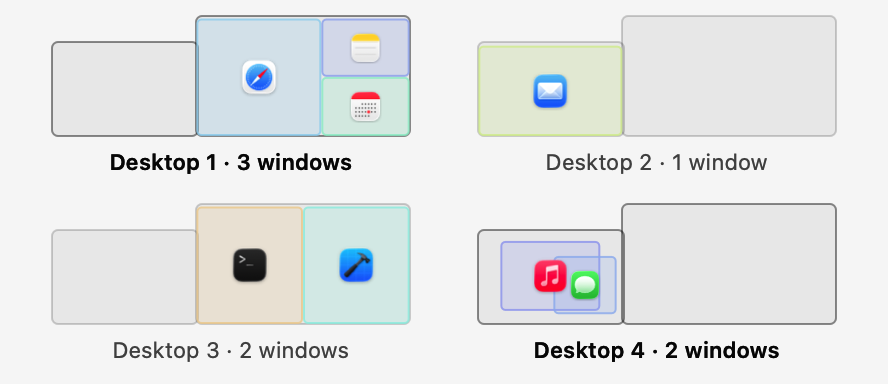

# LayoutKeeper

Remembers how your windows are arranged for each set of monitors and puts them back when that
set is connected again. Native macOS, no dependencies, runs as a LaunchAgent.

<picture>
  <source media="(prefers-color-scheme: dark)" srcset="docs/desktops-dark.png">
  
</picture>

Requires macOS 13 or later and the Swift toolchain (Xcode or the Command Line Tools) to build.

- **Automatic memory.** While your windows sit still, the daemon snapshots their frames for the
  current monitor set ("how I left it last time"). When the monitor set changes (dock/undock,
  clamshell, a new display) or the Mac wakes up, it puts windows back the way you last left them on
  that set, and checks again for a few seconds until they stay put. If the screen is locked it waits
  for the unlock.
- **Pinned layouts.** `layoutkeeper save` pins the current arrangement for the current monitor set: a
  snapshot you can go back to with **Restore Pinned Layout** or `restore --pinned`. Turn on
  **Always Restore the Pinned Layout** (`preferPinned`) to make every restore use it instead.
- **Desktops go back to their monitor.** When a monitor is unplugged macOS moves its desktops onto the
  remaining display, and when it is plugged back in gives it a single fresh desktop. LayoutKeeper
  remembers which desktops (Spaces) belong on which monitor and, on reconnect, drives Mission Control
  to drag them back, removes the empty desktop macOS made up, and adds any that are missing. Desktops
  with windows are never removed. Toggle with **Move Desktops Back to Their Monitor** or `restoreDesktops`.
- **Place on launch.** When an app that is part of the layout is opened (or shows its first window
  again), its windows are moved to where they belong.
- **Arrangement-proof.** Frames are stored relative to the display they were on, so a monitor moved
  in System Settings ▸ Displays does not break restores.
- **Spaces-aware.** macOS only exposes the windows on the current Space to Accessibility clients.
  LayoutKeeper tracks windows by id across Spaces, keeps what it learned about other desktops, and
  finishes a restore for the remaining windows the moment you switch to their Space.

## Install

```sh
scripts/install.sh
```

Builds with the system Swift toolchain, installs the CLI to `~/.local/bin/layoutkeeper`, the daemon
binary to `~/.local/libexec/layoutkeeper/`, a launcher app to `~/Applications/LayoutKeeper.app`, and a
LaunchAgent (`dev.layoutkeeper.agent`). Then enable **LayoutKeeper** under
System Settings ▸ Privacy & Security ▸ Accessibility (one time).

The launcher app is what holds the Accessibility grant and is never rebuilt, so `scripts/install.sh`
can be re-run after code changes without re-granting. If the grant ever looks stuck, run
`scripts/install.sh --reset-tcc` and toggle it again.

## Menu bar

The menu bar item (a window icon; ⚠ when the Accessibility permission is missing, dimmed when paused) shows:

- the connected monitor set and a **thumbnail per desktop** of the open windows that restores will
  put back. The desktops on screen right now are in bold. Click a thumbnail to open it in the Layouts
  window; hover for the apps on it.
- the last action (restore, pin, placement) with its details in a submenu,
- **Restore Layout Now** ⌘R, **Show Layouts…** ⌘L, **Pause** ⌘P,
- **Pinned Layout**: pin the current layout ⌘S, restore the pinned one, or forget it,
- other monitor sets you have used, and a **Settings** submenu with the main switches plus shortcuts
  to the config file, layouts folder and log.

**Show Layouts…** opens a window with a map of every saved layout: pick a monitor set, pinned or
remembered, and a desktop. Windows are drawn on their displays with app icons and listed in a table
with title, display, desktop, position and state. **Show closed apps** adds (dashed) where apps that
are not running were last seen; they are placed there when they open. Positions of apps not opened
for a month are forgotten. Pin, restore and forget from there too. `layoutkeeper open [desktop]`
opens it from the terminal.

## Use

```
layoutkeeper save                  # pin the current layout for the current monitor set
layoutkeeper restore [--dry-run]   # put windows back the way they were last left (--pinned: the pinned snapshot)
layoutkeeper list                  # known monitor sets and what is saved for each
layoutkeeper show [--auto|--pinned] # windows in the saved layout
layoutkeeper status                # daemon + permission + saved layouts
layoutkeeper forget [--pinned|--auto|--all]
layoutkeeper desktops [--dry-run]  # put desktops (Spaces) back on their monitors now
layoutkeeper reload                # tell the daemon to restore, as if a monitor was just connected
layoutkeeper open [desktop]        # open the Layouts window
layoutkeeper render --grid --out preview.png   # draw the saved layout to a PNG (--demo: a made-up one)
```

CLI commands that touch windows are executed by the daemon (which has the Accessibility grant),
so they work from any terminal.

## Config

`~/Library/Application Support/LayoutKeeper/config.json`

| key | default | meaning |
|---|---|---|
| `restoreOnDisplayChange` | `true` | restore when the monitor set changes or the Mac wakes up |
| `restoreDesktops` | `true` | put desktops back on the monitor they belong to when monitors change |
| `autosave` | `true` | keep an automatic layout per monitor set |
| `placeOnLaunch` | `true` | move a newly opened app's windows into place |
| `launchMissingApps` | `false` | open apps that are in the layout but not running |
| `preferPinned` | `false` | restore the pinned layout instead of how the windows were last left |
| `menuBarIcon` | `true` | show the menu bar item |
| `pollSeconds` | `5` | poll interval; autosave runs every `autosaveEveryTicks` polls |
| `debounceSeconds` | `4` | wait after a display event before restoring |
| `ignoreBundleIDs` | `["com.apple.finder"]` | apps never touched |

Layouts live in `layouts/<fingerprint>.json` next to it; log is `~/Library/Logs/LayoutKeeper.log`.

## Tests

```sh
swift run -c release layoutkeeper selftest   # pure logic: matching, display mapping, storage
tests/e2e.sh                                  # drives the running daemon with TextEdit windows
```

The end-to-end test needs the installed daemon with the Accessibility permission. It opens TextEdit,
moves its windows around, and puts your saved layouts back the way they were when it finishes. Wake
from sleep and a locked screen are simulated (`layoutkeeper simulate wake|lock|unlock`), so those paths
run without putting the Mac to sleep.

## Uninstall

```sh
scripts/uninstall.sh            # remove the daemon, app and CLI; keep saved layouts
scripts/uninstall.sh --purge    # also delete saved layouts and settings
```

## Privacy

LayoutKeeper works entirely on your Mac and makes no network connections. It stores window titles,
positions and app names in `~/Library/Application Support/LayoutKeeper` and writes a log to
`~/Library/Logs/LayoutKeeper.log`.

## How the Accessibility grant works

`~/Applications/LayoutKeeper.app` is a tiny launcher that only starts the real daemon. macOS ties an
Accessibility grant to the launcher's code signature, and the launcher is never rebuilt, so
`scripts/install.sh` can update the daemon freely. Child processes inherit the grant, and CLI commands
that need it are executed by the daemon.

## Limitations

- Windows are moved within their current Space; they are not moved between Spaces. Most windows on
  other Spaces are placed right away; the few that cannot be reached there are placed when you switch
  to their Space (within 30 minutes of the restore).
- A window whose app enforces its own size is moved to the saved position and keeps that size.
- Full-screen windows are left alone.
- Desktops are moved by driving Mission Control (there is no API for it without disabling SIP), so
  Mission Control flashes open for a few seconds after a monitor is connected. Desktops that did not
  exist when the layout was saved come back empty.
- Apps whose Accessibility tree is disabled (some Electron apps until they are focused once) are
  skipped until they become reachable.
- Browser/Electron windows are matched by title, size and order; a fully re-arranged set of
  identical windows may be assigned in a different order.
- It relies on a few private macOS calls (Spaces and cross-Space window access, the same ones other
  window managers use). A macOS update can break them; LayoutKeeper then falls back to the windows on
  the current Space.

## License

MIT. See [LICENSE](LICENSE).
